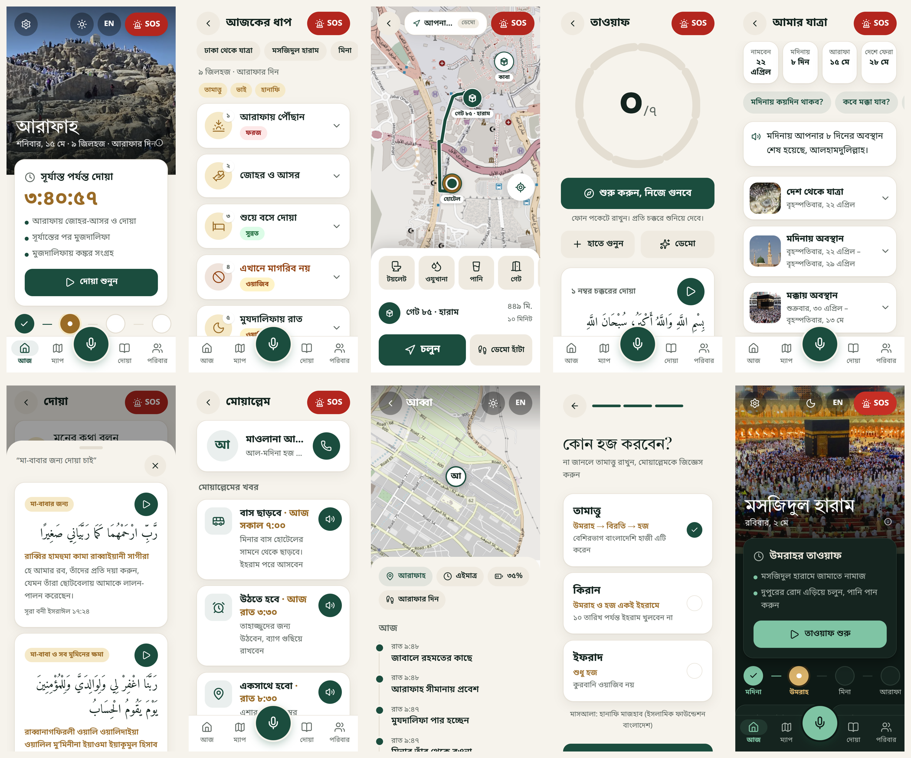
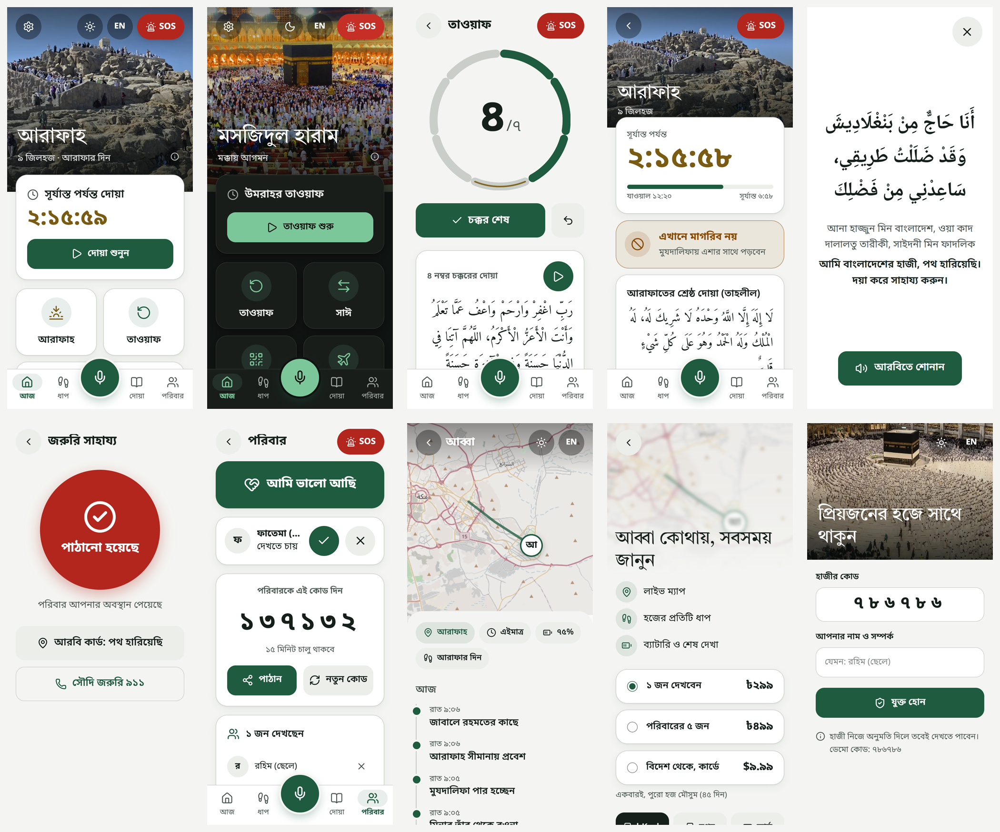

<div align="center">

# মোয়াল্লেম · Moallem

**A calm, voice-first Hajj companion for Bangladeshi pilgrims.**

Bangla first. Big icons, one or two words, and a Moallem in your pocket that knows
where you are, what day of the Hajj it is, and what to do next.




</div>

---

## Why

Most Bangladeshi pilgrims are over 50, many travel for the first time, and the help they get
on the ground is a group leader (the *moallem*) shouting bus times in a crowd. Existing apps are
walls of English text.

Moallem is built as **sadaqah**: the pilgrim app is free forever with no ads, and nothing that
touches worship or safety is ever behind a paywall. The only revenue is the **Hajj Season Pass**
that relatives at home buy to follow their parent on a live map.

## What it does

| | Feature | What the pilgrim sees |
|---|---|---|
| **Today** | Location-aware home | A photo of where you are right now (Haram, Mina, Arafah, Madinah...), the Hijri date, one "Now" card with a countdown |
| **Trip** | Ticket in, whole trip known | Photograph the ticket; every day of the trip is laid out from the Hajj 1448 Umm al-Qura dates. "মদিনায় কয়দিন?" "কবে ফিরব?" answered offline |
| **Steps** | The day's rituals | Each step tagged ফরজ / ওয়াজিব / সুন্নত, adapted to Tamattu, Qiran or Ifrad and to brother or sister |
| **Map** | Nearest X, with guidance | 770 OpenStreetMap points (gates, toilets, wudu, water, clinics). Tap one for WhatsApp-style walking guidance |
| **Tawaf / Sa'i** | Counts itself | Compass + GPS + steps count the rounds; the dua for each round plays. Tapping is only a backup |
| **Arafah** | Sunset mode | Countdown to Maghrib, hands-free duas, and a clear "don't pray Maghrib here" guard |
| **Ask** | Hold to talk, in Bangla | Offline answers for common questions, plus a Qur'anic dua matcher ("মা-বাবার জন্য দোয়া চাই") |
| **Group** | Moallem notices | The group leader posts bus / wake-up / meeting times once; every pilgrim hears them |
| **SOS** | One big button | Sends location to family, calls Saudi 911, shows an Arabic "I am lost" card. Always free |
| **Family** | Live view for relatives | Pilgrim approves each relative by name; they see the map, battery, last seen and which ritual is under way |

<details>
<summary><b>More screens</b></summary>
<br>

</details>

## Principles

- **Icon first.** 1 to 2 word labels, 18px base type, 56px+ tap targets. Warm parchment, deep pine, bronze. Red only for SOS.
- **Safety is never paywalled.** SOS and "আমি ভালো আছি" reach family with or without a pass, even while sharing is paused.
- **Consent before location.** A relative sees nothing until the pilgrim approves them by name. Invite codes expire in 15 minutes.
- **Hanafi, reviewed.** Rulings follow the Islamic Foundation Bangladesh. Every ruling and dua needs Mufti sign-off before launch, so the Ask screen uses vetted offline answers only, never live AI for fiqh.
- **No fake data.** Nothing is shown as "live" unless it is.

## Quick start

Requires **Node 20+**.

```bash
cd app
npm install
npm run dev        # http://localhost:8787
```

Try the demo:

- **Family code** `786786` opens a relative's live view
- **Moallem group code** `313313` joins a group with notices
- **Settings → Demo** teleports the pilgrim (Haram, Mina, Arafah...) and picks a trip date

Optional: set `GEMINI_API_KEY` to scan tickets with Gemini vision (see [`app/.env.example`](app/.env.example)). Without it the app shows a short manual form.

```bash
npm test            # domain logic + server (node:test)
npm run typecheck
npm run build
```

## Repository layout

```
moallem/
├── app/                     PWA + API in one process (Vite, React 19, Tailwind v4, Express)
│   ├── src/
│   │   ├── domain/          pure, tested logic and data
│   │   │                    itinerary, geofences, OSM points, Tawaf/Sa'i trackers,
│   │   │                    prayer times (Umm al-Qura, Hanafi Asr), rulings, duas
│   │   ├── lib/             GPS + compass, trip, group, earbuds, foot routing, family circle
│   │   ├── map/             map screen and Leaflet guide map
│   │   ├── screens/         Today, Steps, Counter, Arafah, Duas, Ask, SOS, Permit, Trip, Group, Family, Settings
│   │   └── family/          relative's view: join, wait, live map, Season Pass
│   ├── server/              routes, Family Circle store, groups, ticket vision, answer cache, demo
│   └── scripts/             OpenStreetMap fetchers for points of interest
├── video/                   Remotion product films, built from real app recordings
│   ├── src/                 v1 film and v2 (src/v2)
│   ├── public/              recordings, screenshots, photos, audio
│   └── scripts/             record / shoot the running app with a browser
├── shared/images/           Wikimedia Commons photos + CREDITS.json (credited in-app)
└── docs/
    ├── PLAN.md              product plan and team-review decisions
    └── screenshots/
```

## Product film

```bash
cd video
npm install
npx remotion studio          # preview
npx remotion render          # export
```

The v2 film uses real screen recordings. To re-record them, run the app on `:8787` and use
`node scripts/record.mjs <outDir>`. See [`video/README.md`](video/README.md).

## Roadmap

**Built:** everything above, running as a PWA with a demo server.

**Next:**

- Supabase backend with phone OTP sign-in
- Real bKash / Nagad / SSLCommerz payments for the Season Pass
- Capacitor Android app with a foreground location service (background GPS, auto-Tawaf with the screen off)
- Pre-recorded Bangla audio for cached answers
- Offline service worker and map tile cache
- Field test of auto-Tawaf in the Mataf
- Hand-mapped Zamzam, water and Madinah / Mashair wudu points (missing from OSM)
- Official geofence polygons in place of circles
- Mufti review of all Bangla ritual text

Target: launch with the first Bangladeshi Hajj flights, April 2027 (Arafah ≈ 15 May 2027).
The full plan is in [`docs/PLAN.md`](docs/PLAN.md).

## Contributing

Read [`docs/PLAN.md`](docs/PLAN.md) first; section 9 records decisions already made. Keep domain
logic pure and tested in `app/src/domain`, keep base CSS inside `@layer base`, and portal full-screen
overlays to `document.body`. Religious content changes need a source and a Mufti's review.

## Credits

Photos are from Wikimedia Commons under CC0 / CC BY-SA; authors and licenses are listed in
[`shared/images/CREDITS.json`](shared/images/CREDITS.json) and shown in the app under Settings.
Map data © OpenStreetMap contributors (ODbL). Routing by OSRM.

<div align="center">
<br>
<sub>Made as sadaqah for the guests of Allah.</sub>
</div>
